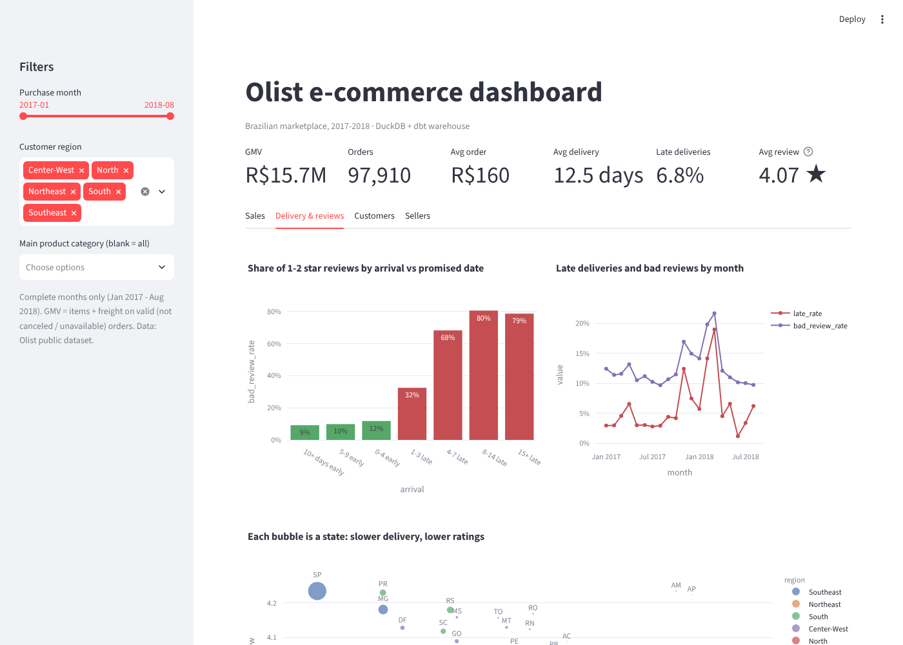
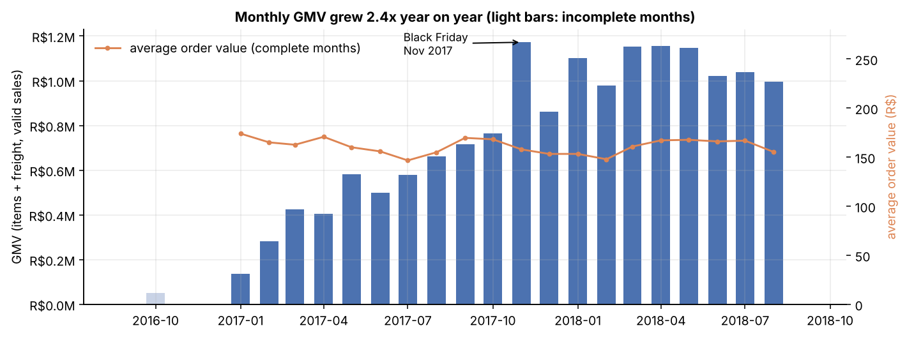
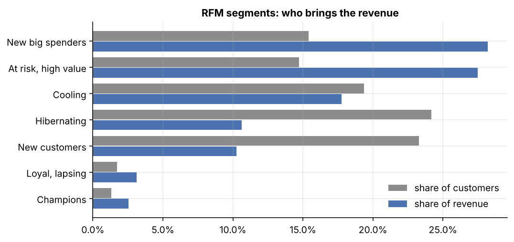
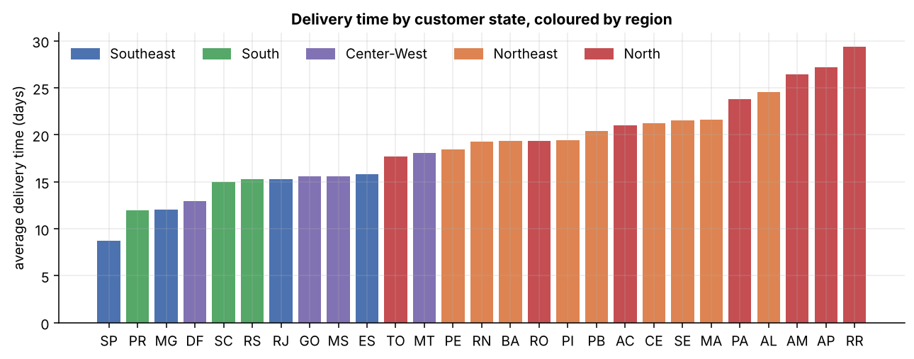
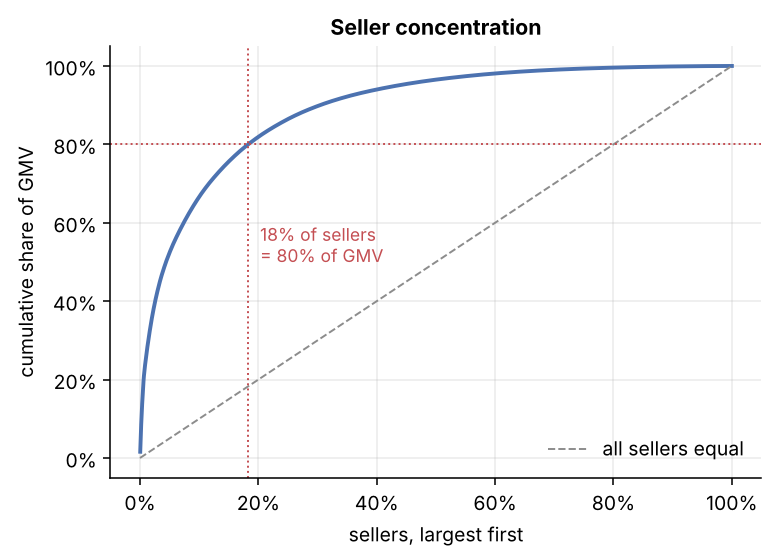
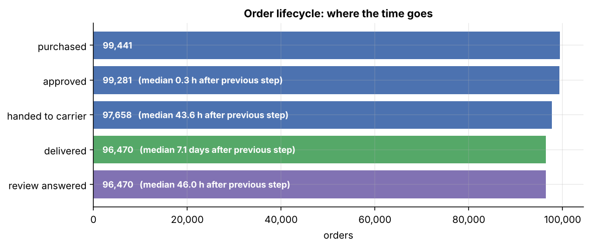

# E-commerce Analytics Warehouse

**A tested star-schema warehouse (DuckDB + dbt) for 100k orders from Olist, a Brazilian marketplace, with the
analysis, statistics and dashboards built on top of it.**


 
 

9 raw tables → 8 staging views → 3 intermediate views → 6 star-schema tables → 8 analytics marts,
**68 data tests** (keys, relationships, accepted values, reconciliations), one command to rebuild.

```bash
pip install -e ".[app,dev]"
olist build        # download (checksummed) → load DuckDB → dbt build: 25 models + 68 tests, ~1 min
olist report       # figures + reports/metrics.json
olist dashboard    # Streamlit app
```

---

## Key findings

| Question | Answer | Evidence |
|---|---|---|
| How fast is the business growing? | GMV **+140%** (Jan–Aug 2018 vs 2017), orders +137%, average basket flat at ~R$160 | growth is volume, not basket size |
| What drives bad reviews? | **Late delivery.** Late orders get 1–2 stars **62.9%** of the time vs **9.5%** on time | bootstrap 95% CI for the gap: 52.1–54.5 pts |
| Does that survive controls? | Yes: odds ratio **18.1** (CI 17.1–19.2) holding region, basket, payment, category fixed | logistic regression, n = 96,469 |
| Is it a gradient? | 1–3 days late: 32% bad · 4–7 days: 68% · 8–14 days: 80%. Arriving early barely helps | dose-response |
| Why do Northeast customers rate lower? | Their orders are late twice as often (12.7% vs 6.1%). With lateness controlled, region has no effect (OR 1.02) | mediation |
| Do customers come back? | **3%** ever reorder; month-1 retention ~0.5% for every 2017 cohort; 30% of "second orders" are same-day | cohort analysis |
| Where is the revenue? | 18% of sellers make 80% of GMV. 39 busy sellers average < 3.5 stars, are late 13% of the time vs 6%, and hold only 4.6% of GMV | Pareto + seller mart |


**Recommendations** (detail in the [executive summary](docs/EXECUTIVE_SUMMARY.md)): set delivery promises the
network can keep and test it with an experiment; send the review survey after the *last* parcel of multi-seller
orders (they get bad reviews 4× as often despite rarely being late); run a quality programme for the 39 low-rated
busy sellers; treat retention, not acquisition, as the growth gap.

---

## Architecture

```
Olist CSVs (GitHub mirror, sha256-checked)
   │  src/olistwh/ingest.py          "EL": copy into DuckDB, untouched
   ▼
raw.*  ──dbt──►  staging.*  ──►  intermediate.*  ──►  core.*  (star schema)  ──►  analytics.*  (marts)
                 clean, dedupe     order rollups        fct_orders               monthly KPIs, cohorts,
                 one row per key   distances            fct_order_items          RFM, lifecycle, sellers,
                                                        dim_customers/products/  states, delivery vs review
                                                        sellers/date
   ▼
analysis.py (statistics) · report.py (figures) · Streamlit app · Power BI export (Parquet + DAX) · 22 SQL drills
```


| Layer | Models | Materialised | Examples of what happens there |
|---|---|---|---|
| staging | 8 | views | 559 duplicate reviews resolved; 1M geolocation rows → 1 median point per zip inside Brazil; 610 products with no category |
| intermediate | 3 | views | items and payments rolled up to orders; seller→customer haversine distance |
| core | 6 | tables | `customer_key` = the person (96,096), not the per-order `customer_id` (99,441) |
| analytics | 8 | tables | KPIs flagged for complete months; cohort retention; RFM segments; seller Pareto |

**Data quality** is a first-class output: [`reports/data_quality.csv`](reports/data_quality.csv) lists every issue
found, its count and how it is handled. Business constants (complete-month window, what counts as a bad review)
are dbt `vars`, defined once.

## Dashboards

**Streamlit** (`olist dashboard`): date, region and category filters; sales, delivery, customer and seller tabs.



**Power BI**: `olist powerbi` exports the star schema to Parquet. [`powerbi/`](powerbi/) has the relationships,
[22 DAX measures](powerbi/measures.dax) each with its expected value, a theme, and a page-by-page build guide.

## More figures

| | |
|---|---|
|  |  |
|  |  |
|  |  |
|  |  |

## Learn from it

The [`docs/learn/`](docs/learn/) folder teaches the project from scratch:

1. [Star schema](docs/learn/01_star_schema.md): facts, dimensions, grain, why two fact tables
2. [dbt and the warehouse layers](docs/learn/02_dbt_warehouse.md): sources, refs, tests, vars, lineage
3. [Metrics and KPI definitions](docs/learn/03_metrics_and_kpis.md): a metric dictionary and nine traps, with real numbers
4. [Analysis and statistics](docs/learn/04_analysis_and_statistics.md): bootstrap CI, odds ratios, confounding vs mediation, dose-response
5. [Power BI and DAX](docs/learn/05_power_bi.md): filter context, CALCULATE, measures vs columns
6. [22 SQL interview questions](docs/learn/06_sql_interview_practice.md) on this warehouse, with real outputs (window functions, cohorts, dedup, anti-joins, fan-out)
7. [Interview questions about this project](docs/learn/07_interview_questions.md)

## Repository layout

```
├── src/olistwh/        ingest · warehouse · analysis · viz · report · powerbi · sqlpractice · cli
├── warehouse/          the dbt project (models, seeds, macros, tests)
├── app/                Streamlit dashboard
├── powerbi/            DAX measures, theme, build guide (data/ is generated)
├── sql_practice/       22 .sql interview questions
├── reports/            figures, metrics.json, CSV outputs (generated, committed)
├── docs/               executive summary, GitHub guide, lessons
├── tests/              pytest: raw counts, cleaning rules, reconciliations, findings, SQL answers, dbt tests
└── data/raw/           CSVs (downloaded, git-ignored)
```

## Commands

| Command | What it does |
|---|---|
| `olist build` | download + load + `dbt build` (add `--skip-load` to re-run dbt only) |
| `olist report` | regenerate figures, CSVs, `reports/metrics.json` |
| `olist powerbi` | Parquet export for Power BI / Tableau |
| `olist sql` / `olist sql 08` | run all SQL drills (rewrites lesson 06) / print one answer |
| `olist dashboard` | Streamlit on http://localhost:8501 |
| `./dbt.sh docs generate && ./dbt.sh docs serve` | dbt docs site with lineage and column docs |
| `pytest` | 53 tests (needs `olist build` first) |

## Limitations

- Data covers Sept 2016 – Oct 2018; months outside Jan 2017 – Aug 2018 are too sparse and flagged.
- The public sample only contains orders with a review, which flatters review coverage.
- GMV is not Olist's revenue (it earns commissions we can't see); no costs or margins.
- Observational data: the late-delivery effect is robust to measured confounders and shows a dose-response, but a
  promised-date experiment would be the way to prove causation.

## Data and license

Code: MIT. Data: [Brazilian E-Commerce Public Dataset by Olist](https://www.kaggle.com/datasets/olistbr/brazilian-ecommerce),
CC BY-NC-SA 4.0, downloaded at build time from a public GitHub mirror and verified by SHA-256; not stored in this
repository.
