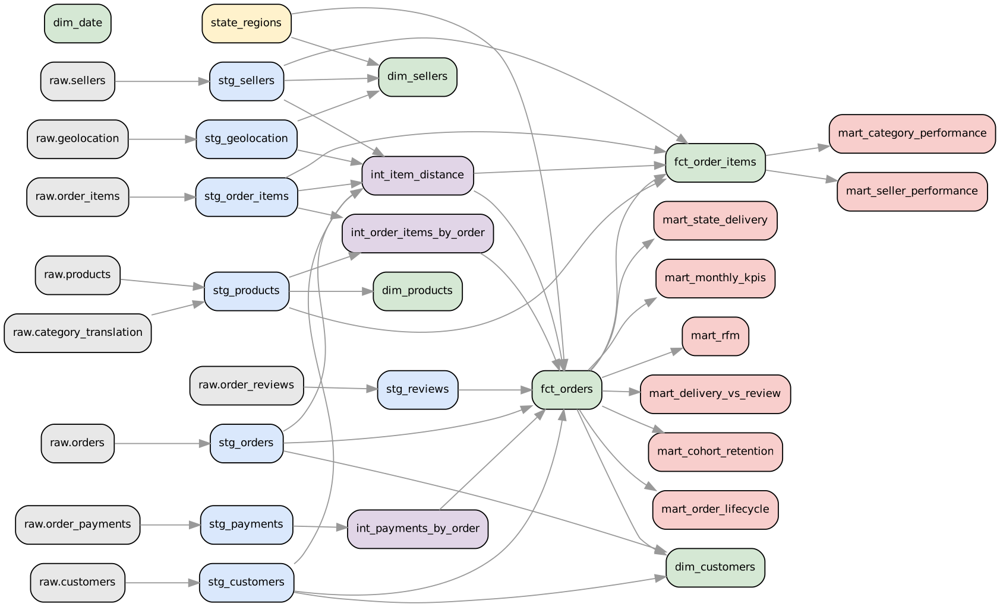

# 02 · dbt and the warehouse layers

## ELT in one picture

```
CSV files ──(Python: download + checksum + load)──► raw.*            "EL": copy, never change
raw.*     ──(dbt SQL models)─────────────────────► staging.*        rename, cast, dedupe, clean
staging.* ──(dbt)────────────────────────────────► intermediate.*   reusable rollups
          ──(dbt)────────────────────────────────► core.*           star schema (facts + dimensions)
          ──(dbt)────────────────────────────────► analytics.*      business-ready marts (KPIs, cohorts, RFM)
```

**ELT** (extract, load, *then* transform inside the warehouse) replaced old ETL because warehouses
(Snowflake, BigQuery, Databricks, Redshift, and here DuckDB on a laptop) are fast enough to transform in SQL, and
keeping an untouched raw copy means you can always rebuild when a rule changes.

**DuckDB** is an analytical database that runs inside your Python process with no server, like SQLite but
column-oriented and fast for aggregates. The whole warehouse is one file: `warehouse/olist.duckdb`.
**dbt** (data build tool) turns a folder of `select` statements into tables and views in dependency order, tests
them, and documents them. The same project would run on Snowflake by changing `profiles.yml`.



## The project, file by file

```
warehouse/
├── dbt_project.yml          project config: which folder becomes a view or table, which schema, vars
├── profiles.yml             connection: DuckDB file path (from the OLIST_DB environment variable)
├── macros/generate_schema_name.sql   use schema names as written (dbt prefixes them by default)
├── seeds/state_regions.csv  27 states → 5 official regions; a small lookup kept in git
├── models/
│   ├── staging/       _sources.yml (declares raw tables) + stg_*.sql, one per raw table   → views
│   ├── intermediate/  int_*.sql: order-level rollups of items and payments, distances     → views
│   └── marts/core/    fct_*.sql, dim_*.sql + _core.yml (docs + tests)                       → tables
│       marts/analytics/ mart_*.sql + _analytics.yml                                         → tables
└── tests/             singular tests (*.sql) and generic tests (tests/generic/)
```

Run it:

```bash
./dbt.sh build                      # every model + every test, in dependency order (94 nodes)
./dbt.sh build -s fct_orders+       # fct_orders and everything downstream of it
./dbt.sh test -s stg_reviews        # tests for one model
./dbt.sh docs generate && ./dbt.sh docs serve    # browsable docs site with the lineage graph
```

(`dbt.sh` just points dbt at `warehouse/`; `olist build` does the same from Python.)

## `ref()` and `source()`: how dbt knows the order

```sql
-- models/marts/core/fct_orders.sql
with orders as (select * from {{ ref('stg_orders') }}),
reviews as (select * from {{ ref('stg_reviews') }}), ...
```

`{{ ref('stg_orders') }}` compiles to `"staging"."stg_orders"` *and* tells dbt that `fct_orders` depends on
`stg_orders`. dbt builds that dependency graph (the picture above) and runs models in the right order. Never
hard-code a table name in a model; use `ref()` for models and `source()` for raw tables.

## Layer rules (and why)

| Layer | Rule | Example here |
|---|---|---|
| staging | 1:1 with a raw table. Rename to clear names, cast types, fix *data* problems. No joins, no business logic. | `stg_reviews` keeps 1 review per order; `stg_geolocation` keeps 1 median point per zip inside Brazil |
| intermediate | Reusable building blocks that would otherwise be repeated | `int_order_items_by_order`: items → one row per order |
| core marts | The star schema; business definitions live here | `is_valid_sale`, `is_late`, `customer_key` |
| analytics marts | Answers to recurring questions, ready for a dashboard | `mart_monthly_kpis`, `mart_cohort_retention`, `mart_rfm` |

Staging and intermediate are **views** (no storage, always fresh); marts are **tables** (fast for dashboards).
That is set once per folder in `dbt_project.yml`, not per file.

## Cleaning decisions, each one visible in code

| Raw problem | Count | Fix (file) |
|---|---|---|
| Orders with more than one review | 559 | keep the latest answered (`stg_reviews`) |
| Geolocation: 1M rows, many per zip, some outside Brazil | 1,000,163 | median per zip inside the bounding box (`stg_geolocation`) |
| Products with no category | 610 | `'unknown'` (`stg_products`) |
| Categories with no English name | 2 | keep Portuguese (`stg_products`) |
| `customer_id` is per order | 3,345 extra ids | use `customer_unique_id` (`fct_orders`) |
| "delivered" orders with no delivery date | 8 | `is_delivered = false` (`fct_orders`) |
| Sparse first/last months | 2016-09 to 2016-12, 2018-09 to 2018-10 | `is_complete_month` flag; vars in `dbt_project.yml` |

The full table with live counts is regenerated into `reports/data_quality.csv`.

## Tests: 68 of them

dbt tests are SQL queries that return the **rows that break a rule**. Zero rows = pass.

**Generic tests** are declared in YAML next to the column:

```yaml
- name: order_id
  tests: [unique, not_null]
- name: customer_key
  tests:
    - relationships: {arguments: {to: ref('dim_customers'), field: customer_key}}
- name: review_score
  tests:
    - accepted_values: {arguments: {values: [1, 2, 3, 4, 5], quote: false}}
```

Three are custom, written in `tests/generic/`. This is the whole of `non_negative`:

```sql

select * from {{ model }} where {{ column_name }} < 0

```

**Singular tests** are one-off business rules in `tests/*.sql`, e.g. "the monthly KPI table adds up to the fact
table to the cent":

```sql
select 1
from (select sum(gmv) as kpi from {{ ref('mart_monthly_kpis') }}) k,
     (select sum(order_value) as fact from {{ ref('fct_orders') }} where is_valid_sale) f
where abs(k.kpi - f.fact) > 0.01
```

Reconciliation tests like this catch the most damaging bug in analytics: a dashboard that silently disagrees with
finance.

**Severity.** `assert_payments_match_order_value` is set to `warn`: 0.26% of orders' payments differ from items +
freight (interest on installments, vouchers). That is real-world behaviour, not a pipeline bug, so it should not
block the build. The test only returns a row (and dbt prints a warning) if the share rises above 0.5%, which would
mean something new is going on.

## Vars: one place for business constants

```yaml
vars:
  first_complete_month: "2017-01-01"
  last_complete_month: "2018-08-01"
  bad_review_max_stars: 2
```

Used as `{{ var('bad_review_max_stars') }}`. If the business decides 3 stars is also "bad", change one line.

## Try it

1. Change `bad_review_max_stars` to 3 and run `./dbt.sh build -s fct_orders+`. What happens to the bad review
   rate in `mart_monthly_kpis`? Change it back.
2. Break something on purpose: in `stg_reviews.sql`, change `where rn = 1` to `where rn <= 2`, run
   `./dbt.sh build`. Which test fails, and why does dbt then *skip* everything downstream?
3. Add a test that `delivery_days` is never negative (hint: the `non_negative` generic test).

Next: [03 · Metrics and KPI definitions](03_metrics_and_kpis.md)
