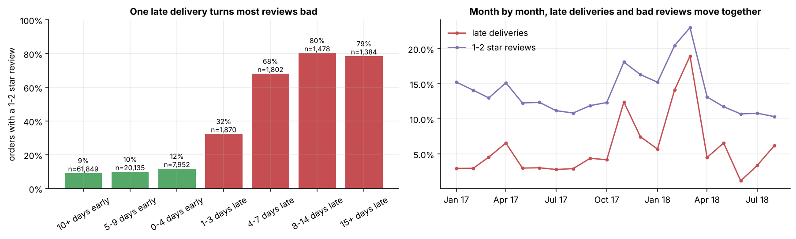
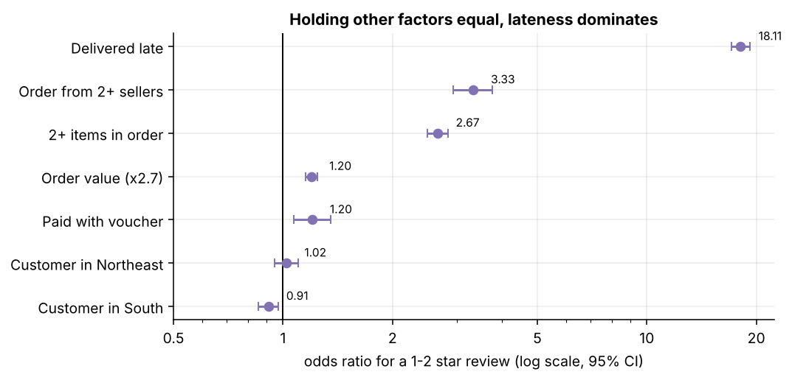
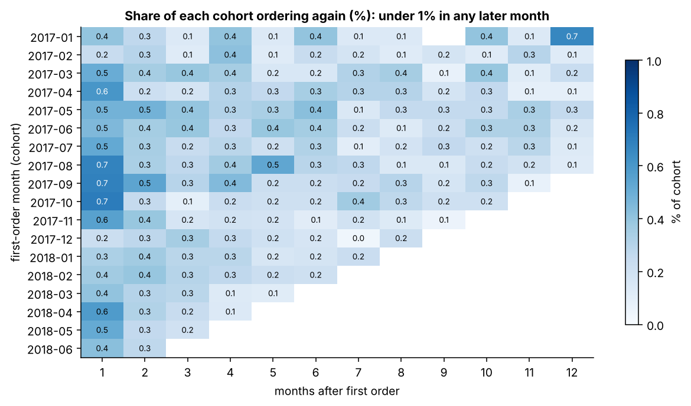
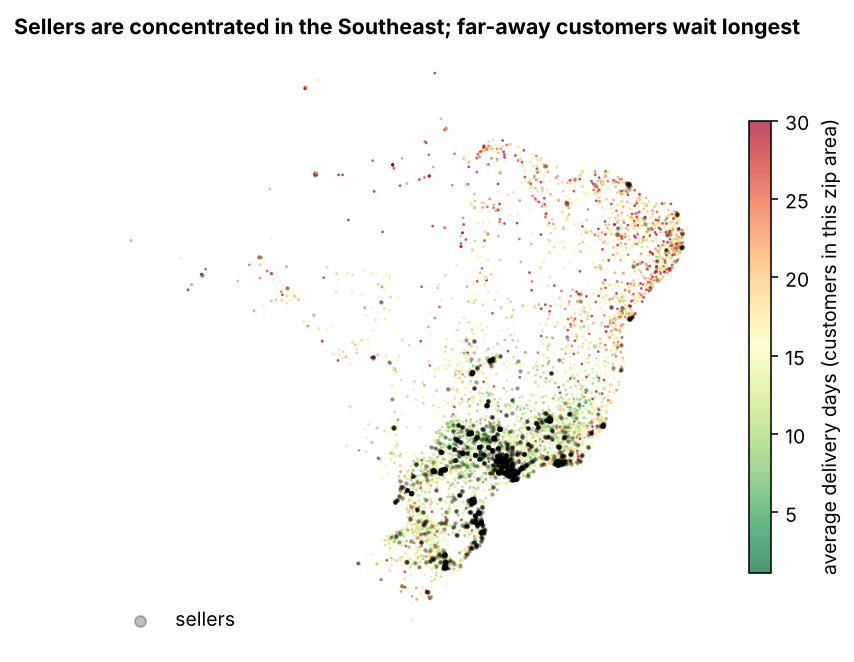

# 04 · Analysis and statistics: from a chart to a defensible claim

A warehouse makes numbers *consistent*. Analysis makes them *mean something*. This lesson follows one question
end to end, the way you would in a real job, and then covers the other findings more briefly. Code:
`src/olistwh/analysis.py`. Every number here is regenerated into `reports/metrics.json` by `olist report`.

## The question: do late deliveries cause bad reviews?

### Step 1: describe

```sql
select is_late, count(*), avg(review_score), avg(is_bad_review::int)
from core.fct_orders where is_delivered and has_review group by 1;
```

| | orders | avg review | 1–2 star share |
|---|---|---|---|
| on time | 89,936 | 4.28 | 9.5% |
| late | 6,534 | 2.26 | 62.9% |

A difference of **53 percentage points**. Late orders are only 6.8% of deliveries but produce **32% of all bad
reviews**.

### Step 2: how sure are we? (bootstrap confidence interval)

A difference from one sample could be luck. The **bootstrap** estimates how much it would wobble if we could
re-run history: resample the late orders *with replacement* (same size), resample the on-time orders, recompute
the difference, repeat 2,000 times. The middle 95% of those differences is the 95% confidence interval.

```python
boots = [rng.choice(late, len(late)).mean() - rng.choice(on_time, len(on_time)).mean() for _ in range(2000)]
lo, hi = np.percentile(boots, [2.5, 97.5])      # → 52.1 to 54.5 points
```

Why bootstrap rather than a formula? It needs no distribution assumption and works for any statistic (a median, a
ratio, a percentile) the same way. With 96k orders the textbook two-proportion z-interval gives almost the same
answer; it is good to say that in an interview.

### Step 3: dose-response

If lateness really drives ratings, *more* lateness should mean *worse* ratings, smoothly:



| Arrival vs promise | 10+ days early | 0–4 early | 1–3 late | 4–7 late | 8–14 late |
|---|---|---|---|---|---|
| 1–2 star share | 9% | 12% | 32% | 68% | 80% |
| avg review | 4.31 | | 3.28 | 2.09 | 1.67 |

A monotonic gradient is one of the classic signs (from epidemiology's Bradford Hill criteria) that a relationship
is causal rather than a coincidence. Note also the cliff at the promised date: arriving *early* barely helps,
arriving *late* hurts a lot. The **promise** is what customers judge.

### Step 4: rule out confounders (logistic regression)

Maybe late orders are different in other ways: further away (Northeast), bigger, multi-seller, certain
categories. Those could cause both lateness *and* bad reviews (**confounding**). A logistic regression estimates
the effect of `late` while holding the others fixed:

```python
smf.logit("bad ~ late + C(region) + log_value + freight_share + multi_item + multi_seller"
          " + C(payment) + C(category)", data=d)
```



**Reading an odds ratio (OR).** Odds = p / (1 − p). An OR of 18.1 for `late` means the odds of a bad review are
18 times higher for a late order *with the same region, basket, payment and category*. 95% CI 17.1–19.2, so the
effect is large and precise. OR = 1 means no effect; < 1 protective.

**Careful:** an OR is not "18 times more likely". When the outcome is common (13% here), odds ratios exaggerate
the risk ratio. The plain-language version is the raw comparison: **62.9% vs 9.5%, about 6.6 times as likely**.
Report the OR to show the effect survives controls; report the risk difference/ratio to people.

**What the controls revealed.** Region looked important on its own (Northeast averages 3.95 stars vs 4.17 in the
Southeast; a model with region alone gives the Northeast an OR of 1.42), but in the full model the Northeast OR
is **1.02** (CI 0.95–1.10, not significant). The Northeast's lower
ratings are almost entirely *because* its orders are late more often (12.7% vs 6.1%). That is **mediation**:
region → lateness → rating. Distance is a cause of lateness, not a separate reason for unhappiness.

The second-largest effect is **multi-seller orders (OR 3.3)**, even though they are *rarely* recorded late (1% vs
6.9%). Each seller ships separately and the recorded delivery date is when the order counts as delivered; the
likely story is customers reviewing while part of their order is still missing. 65% of those reviews include a
written comment vs 41% normally. That is a hypothesis to check by reading comments, and a concrete product idea
(review survey after the *last* parcel).

### Step 5: is it stable over time? (Spearman correlation)

Across the 20 complete months, months with more late deliveries have more bad reviews: **Spearman ρ = 0.59**
(p = 0.006). Spearman correlates *ranks*, so it is robust to the two extreme months (Feb and Mar 2018, late rates
of 14% and 19%, bad-review rates of 20% and 23%). Twenty points is a small sample; this is supporting evidence,
not the main proof. (Why were those months late? The data can't say; that is a question for the operations team.)

### Step 6: what we can and can't claim

This is observational data, not an experiment. We have (1) a huge, precise difference, (2) a dose-response
gradient, (3) robustness to measured confounders, (4) consistency over time, and (5) a plausible mechanism (the
customer saw the promised date at checkout). That is strong evidence. It is *not* proof: unmeasured factors
(e.g. a seller who is both slow and sells poor products) could contribute. The clean test would be an
**experiment**: e.g. randomly give some orders a more conservative promised date and compare ratings. (See the
ab-testing-toolkit project for how to design and size that test.)

How to say it: *"Late delivery is the strongest driver of bad reviews we can measure: late orders get 1–2 stars
63% of the time vs 9.5%, the effect grows with each day of delay, and it holds after controlling for region,
order size, payment and category (odds ratio 18, CI 17–19). We'd confirm causality with a promised-date
experiment."*

## Other findings, briefly

**Growth.** Jan–Aug 2018 GMV +140% vs Jan–Aug 2017, with AOV flat (R$158 → R$161): growth is volume, not basket
size. Black Friday 2017 had 1,166 orders in a day vs a November median of 186.

**Retention.** 3% of customers ever return; month-1 retention is ~0.5% for every 2017 cohort
(heatmap below). The business is acquisition-driven. Even a small lift in repeat purchase would be large in
revenue terms, and the late-delivery finding suggests where to start: a bad first experience is a reason not to
return.



**Concentration (Pareto).** 18% of sellers make 80% of GMV; the top 10% make 67%. Of the 634 sellers with 30+
orders, 39 average below 3.5 stars; they are only 4.6% of GMV and their late rate is 13.1% vs 6.0%. A targeted
seller-quality programme touches few sellers and little revenue.

**Geography.** Sellers are concentrated in São Paulo. Delivery takes 10.8 days in the Southeast and 20–23 days in
the North and Northeast, where freight is also a bigger share of the price (18.5% vs 13%).



## Statistical vocabulary used here

| Term | One-line meaning |
|---|---|
| Confidence interval | range of values compatible with the data; 95% CI means the method captures the truth 95% of the time |
| Bootstrap | estimate uncertainty by resampling your own data with replacement |
| Odds ratio | ratio of odds between two groups; > 1 means higher odds of the outcome |
| Confounder | a variable that affects both the "cause" and the outcome, creating a fake or inflated link |
| Mediator | a variable *on the path* between cause and outcome (region → lateness → rating) |
| Dose-response | more exposure → more effect; evidence for causation |
| Spearman ρ | correlation of ranks; robust to outliers, measures monotonic (not just linear) association |
| p-value | how surprising the data would be if there were no effect; not the probability the effect is real |

## Try it

1. In `analysis.late_review_model`, remove `late` from the formula. What happens to the Northeast odds ratio?
   (It rises from 1.02 to about 1.29: that is the confounding/mediation story in one experiment.)
2. Replace the bootstrap with a two-proportion z-interval (`statsmodels.stats.proportion.confint_proportions_2indep`).
   How different is it?
3. Is the late effect the same for cheap and expensive orders? Add `late:log_value` (an interaction) to the formula.

Next: [05 · Power BI and DAX](05_power_bi.md)
